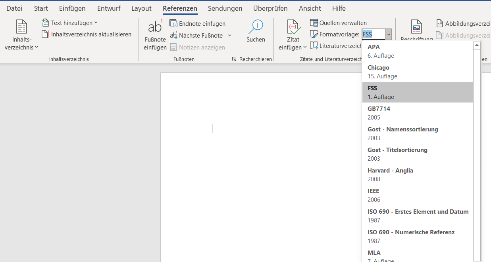

# FSS Zitierstil

Der FSS-Zitierstil ist ein auf der deutschen Zitierweise basierender **Zitierstil für MS Word**, der für die Zitation von Quellen in wissenschaftlichen Arbeiten vorgesehen ist.

Dieses Projekt entstand in Zusammenhang mit einer Schulaufgabe im Rahmen einer Seminararbeit an der Ferdinand-von-Steinbeis-Schule Ulm.
Die Motivation hinter diesem Projekt ist es, die automatisierte Erstellung von korrekt formatierten Zitationen zu ermöglichen und dabei die Effizienz zu steigern, sowie die Fehleranfälligkeit zu minimieren.

## Installation
Unter [Releases](https://github.com/tobiaskirchmaier/fss-quotation-styles/releases) finden Sie den Installer `fss_installer.zip`. Entpacken Sie diesen nach dem Download und führen Sie durch Doppelklick auf `FSSStyleInstaller.exe` die Installation durch.

Falls Sie bereits MS Word geöffnet haben, so starten Sie MS Word neu. Die Installation ist abgeschlossen. Der Installer kann gelöscht werden.

## Implementierungsgrad
Aktuell werden die folgenden Quellentypen unterstützt:
- `Buch`
- `Buchabschnitt`
- `Zeitungsartikel`
- `Artikel in einer Zeitschrift`
- `Konferenzprotokoll`
- `Bericht`
- `Website`
- `Dokument von Website`
- `Elektronische Quelle`
- `Kunst`
- `Tonaufnahme`
- `Aufführung`
- `Film`
- `Interview`
- `Patent`
- `Fall`
- `Verschiedenes`
